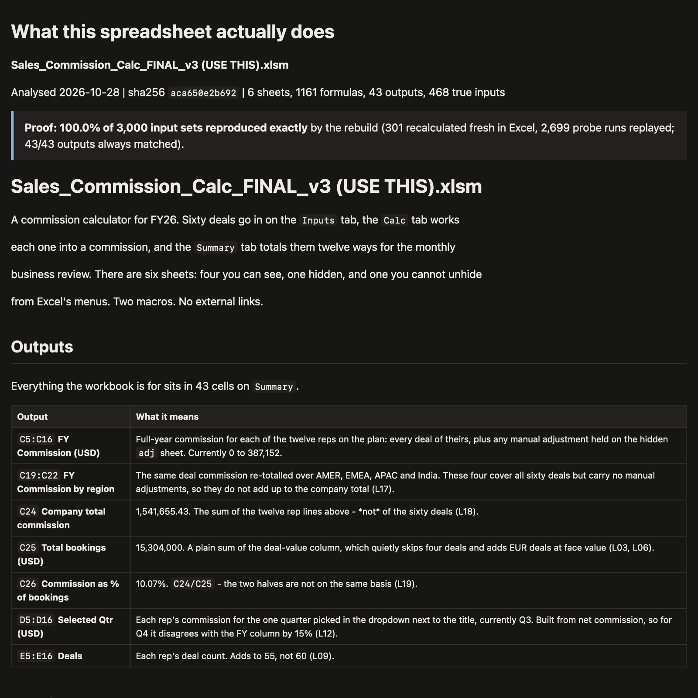

# reverse-engineer-sheets

A Claude Code skill for the spreadsheet nobody understands any more. Point it at an inherited Excel workbook and it tells you what the workbook really does: every input and output, every hidden sheet, macro and dead link, with each claim tagged as something it saw, something it inferred, or an open question for whoever built the file.

It doesn't stop at reading formulas. It recalculates the original in real Excel, rebuilds the logic in Python, and proves that the rebuild produces the same numbers.

## Use it

You need Claude Code, Python 3.11 and Microsoft Excel (macOS or Windows). LibreOffice works as a fallback when Excel isn't installed, with caveats.

1. **Install**
   ```
   git clone https://github.com/Akshat2430/reverse-engineer-sheets.git
   cd reverse-engineer-sheets
   ```
   macOS or Linux:
   ```
   python3.11 -m venv .venv && .venv/bin/pip install -r requirements.txt
   ```
   Windows:
   ```
   py -3.11 -m venv .venv
   .venv\Scripts\pip install -r requirements.txt
   ```
2. **Open Claude Code in the folder:** `claude`
3. **Run it on your file:** `/reverse-engineer path/to/your_workbook.xlsx`

Your original file is never touched; everything happens on a copy in `runs/`. Expect 30 to 90 minutes for a real workbook, mostly Excel recalculating test cases. You get `REPORT.html` in the run folder: what each output means, how the logic flows, the evidence ledger, the open questions as a meeting agenda, and the proof result.

Workbook contents are sent to the model provider. Don't run it on a confidential file outside an approved environment.

## See a finished run

[`runs/demo/Sales_Commission_Calc_FINAL_v3/`](runs/demo/Sales_Commission_Calc_FINAL_v3/) is a complete run on one of the sample workbooks: the report ([`REPORT.md`](runs/demo/Sales_Commission_Calc_FINAL_v3/REPORT.md), or download `REPORT.html`), the evidence ledger, the Python rebuild and the proof.



## What it does

| Stage | What happens |
|---|---|
| Inventory | Lists everything that hides problems: hidden and very hidden sheets, white-on-white text, macros, external links, broken names, error-swallowing formulas |
| Map | Builds the dependency graph: which cells are true inputs, which are outputs, what feeds what |
| Probe | Changes one input at a time in real Excel and records which outputs move |
| Ledger | Writes every finding as **SEEN** (quotable evidence), **INFERRED** (evidence plus what would confirm it) or **UNKNOWN** (who could settle it) |
| Rebuild | Rewrites the workbook's logic in Python, bugs included, plus a clean readable workbook |
| Prove | Runs random inputs through both Excel and the rebuild and compares every output |
| Report | One page: outputs, logic, ledger, open questions, proof |

More detail, including why each piece exists: [HOW_IT_WORKS.md](HOW_IT_WORKS.md).

## How well it works

We tested it on three deliberately nasty sample workbooks in [`samples/`](samples/): a sales commission calculator, a rolling forecast with a circular cash calculation, and a pricing approval matrix.

**Each rebuild matched Excel on 300 unseen random cases per workbook, to six decimal places** (large totals, such as a multi-million cash balance, to within one part in a billion). The random cases were drawn after the runs finished, so no rebuild was tuned to them. The proof reports are in [`docs/proof/`](docs/proof/).

We haven't yet published a measure of how many problems it finds, because the only scored workbooks so far are ones the skill was developed against. A holdout test on a workbook built independently is next.

## Repo layout

| Path | What it is |
|---|---|
| `.claude/skills/reverse-engineer/` | The skill: instructions, the Excel gotchas checklist, ledger rules, probe recipes |
| `sheetre/` | The toolkit the skill drives: inventory, map, probe, prove, report, and `excelfn` (Excel's lookup, rounding and date behaviour in Python) |
| `tests/` | Toolkit tests (`.venv/bin/python -m pytest`) |
| `samples/` | The three test workbooks and a clean control workbook |
| `runs/demo/` | One finished run, so you can see the output without running anything |
| `scoring/`, `docs/` | How the skill was measured; you don't need these to use it |

## License

MIT, see [LICENSE](LICENSE).
